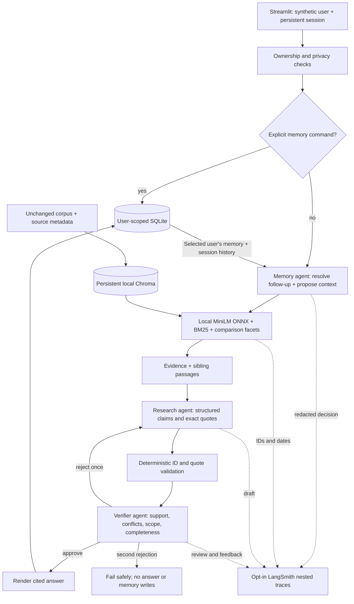

# Design note

## Problem and choices

The system must combine documentary research with user continuity without turning a remembered statement into company evidence. The corpus is small (75 chunks), so a sequential pipeline with explicit handoffs is easier to inspect and validate than a large autonomous team. Each agent owns a distinct decision and can change the next step.

## Agent responsibilities

1. **Memory and Context agent:** reads only the selected user's durable context and current session's bounded history. Resolves pronouns and plan-specific follow-ups into a standalone search query. Proposes updates with an exact quote from the current user message. The application rejects unsupported keys, unsafe values and quotes absent from the message. An unrelated/schema-placeholder query rewrite falls back to the real user question. If a personal plan question has no plan context or hint, a local guard asks for clarification before any generation call; company documents cannot identify a user's plan. Turning automatic memory off suppresses proposals while retaining follow-up resolution.
2. **Research agent:** receives the resolved question, clearly marked user context, source text and all source metadata. Produces at most eight claims with chunk IDs and exact supporting quotations. Resolves conflicts by topic, effective date, version, scope and explicit supersession. It can abstain or ask for clarification.
3. **Verifier agent:** independently checks semantic support, scope, contrary evidence and answer completeness. Unknown citations and altered evidence are rejected deterministically. Whitespace and typographic hyphen variants are first mapped back to exact source text; words and numbers are never normalized away. A rejected draft returns concrete feedback to Research for one revision. A second failure produces no unverified answer.

Memory extraction and semantic verification use the same configured generation model, with separate prompts and structured contracts. This is collaboration by responsibility, not model diversity. Correlated model errors remain possible. Explicit memory commands bypass generation because deterministic deletion/correction should not depend on model availability.

## Retrieval and temporal reasoning

- FastEmbed executes a 384-dimensional MiniLM ONNX model locally on CPU. Chroma persists vectors locally; automatic Chroma embedding functions are disabled.
- SHA-256 verifies the original corpus. The collection name depends on corpus hash and embedding-model name to avoid mixing incompatible indexes.
- The dense baseline ranks cosine distance. The final mode combines dense and BM25-style lexical rankings through reciprocal rank fusion.
- Explicit comparisons and multiple substantial questions are decomposed into at most four facets. Preserve the best full-query passages, retrieve each facet, and limit repeated documents for breadth at a fixed eight-chunk initial budget.
- Add sibling passages from the top two retrieved documents up to fourteen total chunks for synthesis. This preserves local qualifications that a single chunk may omit.
- Generation sees original `published`, `version`, `category`, `chunk_id`, title and text. Repeated owner/source URL fields stay available in the corpus/UI but do not consume generation quota. No global "newest document wins" rule is used.

Example: the 2026 retention policy explicitly supersedes the 2025 security overview's cold-storage figure. The employee handbook overrides an older runbook's stipend without changing the runbook's incident severity definitions. A source's authority is topic-specific.

## Memory model and lifecycle

SQLite tables: `sessions(user_id, session_id)`, `messages(user_id, session_id, role, content)`, and `memories(user_id, key, value, provenance, updated_at)`. All read/write paths include the user boundary, and session operations validate ownership. Transactions, foreign keys, WAL and bounded lock waits provide local persistence.

Only five durable keys are permitted: workspace plan, project region, project name, response style and work goal. Store clear user context, not company facts, all conversation text as memory, inferred sensitive traits, API credentials or speculative assistant output. Automatic updates are committed only after the answer passes verification. Explicit commands work without provider credentials.

The current session provides follow-up context. A new session receives durable selected context; it does not receive all earlier transcripts. Every answer still needs retrieved company evidence. Memory has user-statement provenance, never documentary authority.

**Correction:** replacing a memory value clears that user's prior messages across all sessions, removing old contradictory context before later requests can read it. The current answer uses the proposed correction immediately.

**Forgetting:** delete the requested item or all items and clear that user's old messages across sessions. Do not record the forget command as a new message. Clear transient UI result state as well. SQLite secure deletion and a WAL checkpoint reduce recoverable local remnants, but this is an application-level deletion guarantee, not forensic erasure of backups or disk snapshots. Exported LangSmith traces require separate management.

## Observability and privacy

Nested spans show agent decisions, evidence IDs/dates, rejected drafts, repair feedback and final statuses. They share the conversation root trace. Hash user identifiers and redact common email/credential patterns. Do not automatically serialize Settings or provider headers. Tracing is opt-in and requires a LangSmith key. Use synthetic data in all shared demonstrations.

Common credentials and sensitive personal terms are blocked before model, trace and history calls. These checks are conservative heuristics rather than comprehensive DLP; arbitrary personal data and novel secret formats cannot be reliably recognized. The user selector is a demonstration boundary, not secure authentication.

## Failure handling and trade-offs

- Missing provider configuration is explicit; browsing and memory controls remain available.
- HTTP timeouts, transport disconnects, network errors, 429 and 5xx have bounded retries. Numeric Retry-After is capped at sixty seconds; a missing header on 429 uses a twenty-second fallback. Authentication errors are not retried. No raw provider error body is exposed.
- Invalid JSON fails safely. Bad evidence can cause one repair cycle, then a safe refusal. An answer with valid citations can still misinterpret a quote; the model verifier reduces but cannot eliminate this risk.
- Automatic memory depends on the generation model. Explicit UI/command paths provide deterministic control even when extraction fails.
- Corrections/forgetting discard old conversations rather than trying to redact specific phrases. This is conservative and easy to explain, but loses useful history.
- The local SQLite store is unencrypted. Production authentication, encryption-at-rest key management, authorization and remote deployment are outside this demonstration.
- One model for all agents minimizes setup and cost but risks correlated reasoning errors. A hosted question normally uses three model calls and can use five after revision. Local Ollama quality/speed depends on the selected model and hardware.
- Embeddings truncate very long input; corpus chunks are short. No cross-encoder reranker or streaming generation is implemented.
- Comparison breadth can reduce early ranking precision. The authored small benchmark supports limited conclusions. Actual provider research and memory outcomes are recorded separately from retrieval metrics in the submission index.
